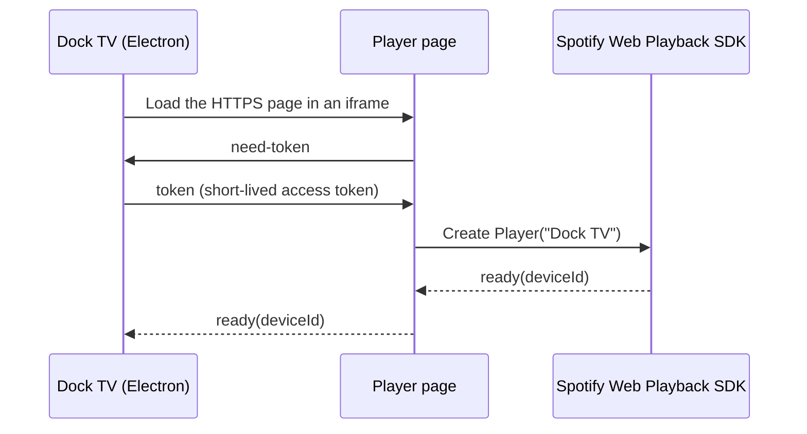

<div align="center">

# Dock TV Spotify Player

**The HTTPS page that gives Dock TV a Spotify Connect device.**


[Main project](https://github.com/youssefsadquy/dock-tv) · [Dock TV releases](https://github.com/youssefsadquy/dock-tv/releases)

</div>

## Why this exists

The Spotify Web Playback SDK only runs in a secure browser context. Dock TV runs its launcher on a Samsung TV, so this small static page provides an HTTPS origin where the SDK can create a playback device named **Dock TV**.

Dock TV owns the Spotify OAuth flow and sends short-lived access tokens to this page at runtime. This repository contains no client secret, refresh token or user credential.

## How it works



The page reports its state on screen so the TV can show whether HTTPS, the SDK, Widevine and the player are ready. That is useful when debugging a TV browser that lacks a required media feature.

### Message protocol

| Direction | Message | Purpose |
|---|---|---|
| Page to Dock | `{ type: "hello" }` | Page loaded |
| Page to Dock | `{ type: "sdk-ready" }` | Spotify SDK finished loading |
| Page to Dock | `{ type: "need-token" }` | Request an access token |
| Dock to Page | `{ type: "token", token }` | Supply a short-lived token |
| Dock to Page | `{ type: "token-error" }` | Token request failed |
| Page to Dock | `{ type: "ready", deviceId }` | Playback device is registered |
| Dock to Page | `{ type: "activate" }` | Unlock audio after a user gesture |
| Dock to Page | `{ type: "show" }` / `{ type: "hide" }` | Show or hide the status screen |
| Page to Dock | `{ type: "close" }` | Back key pressed on the status screen |

## Deploy

There is no build step. Publish `index.html` on any HTTPS static host, for example GitHub Pages, Cloudflare Pages or Netlify. The included `.nojekyll` file keeps GitHub Pages from processing the folder with Jekyll.

1. Deploy the repository to an HTTPS URL.
2. Open Dock TV and add that URL as the Spotify player page.
3. Sign in with a Spotify account that has Premium, because the Web Playback SDK requires it.
4. Use the status screen to confirm the SDK and Widevine are available.

For a locked-down deployment, set a `Content-Security-Policy` with `frame-ancestors` limited to the Dock TV origin and restrict script sources to `https://sdk.scdn.co`.

## Local testing

Open `index.html` through an HTTPS server, not `file://`. The page will display its diagnostics and ask for a token, but playback only works when it is embedded by Dock TV and receives a valid token.

```text
index.html   Player page, SDK loader, diagnostics and postMessage bridge
.nojekyll    Keeps GitHub Pages from running Jekyll
```

## Security notes

- Access tokens are held in memory for the lifetime of the page and are never written to storage.
- The Dock app is responsible for refreshing tokens before they expire.
- Do not reuse this page as a general-purpose token receiver. Deploy it for Dock TV only, with an appropriate frame policy.
- Spotify, Samsung and Tizen are trademarks of their respective owners.

## Related repository

- [dock-tv](https://github.com/youssefsadquy/dock-tv): the Windows app, TV launcher, installer and documentation.
